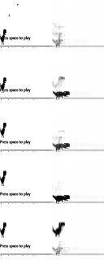

# Chrome Dino World Model

An experimental model-based reinforcement learning project that aims to teach
an agent to play the Chrome Dino game by learning a compact model of the game
world from pixels.

The long-term goal is to build the learning system from scratch in PyTorch. The
planned agent will use a Variational Autoencoder (VAE) to compress game frames,
an action-conditioned Mixture Density Network Recurrent Neural Network
(MDN-RNN) to model possible future latent states, and latent imagination (or
"dreaming") to improve its policy without interacting with the real game for
every training step.

> [!WARNING]
> **Early development / pre-alpha:** this repository is public for development
> visibility. It is not yet a complete or trained world-model agent, and its
> APIs, project structure, and setup process may change frequently.

## Current status

As of October 13, 2026, the environment, offline-data workflow, VAE vision
model, latent encoder, MDN-RNN, and first online controller-training pipeline
are operational. Dream rollouts and reproducible end-to-end evaluation have not
started yet.

| Area | Status | Details |
| --- | --- | --- |
| Chrome Dino environment | Implemented | Launches `chrome://dino` through Selenium and exposes `reset()` and `step()` methods. |
| Visual observations | Implemented | Captures the active runner area and normalizes it into thresholded grayscale NumPy frames (64 x 64 by default). |
| Action controls | Implemented | Supports run, jump, crouch, and fast-drop inputs. |
| Rewards and episode endings | Prototype | Gives a small survival reward and detects collisions through the game's JavaScript state. |
| Demo loop | Implemented | Samples weighted random actions and displays the processed observation with OpenCV. |
| Data collector | Prototype | Runs a weighted-random policy, pairs observations with actions, resets after collisions, and saves compressed NumPy data. |
| Collected dataset | Available | Includes 10,000 aligned frame/action samples in `dataset/dino_data.npz` and a 5 x 5 preview grid. |
| Dataset inspector | Implemented | Reports shapes, dtypes, and action distribution and provides interactive frame-by-frame playback. |
| Sequence pipeline | Prototype | Builds overlapping 32-step `(latent, action)` windows and one-step-shifted latent targets; episode boundaries are not represented yet. |
| VAE representation model | Prototype | A convolutional VAE compresses 64 x 64 frames into a 16-dimensional stochastic latent space and reconstructs them. |
| VAE training | Implemented | Trains for 20 epochs with Adam using reconstruction and KL-divergence losses, with automatic CUDA/CPU selection. |
| Vision artifacts | Generated | Training produces `checkpoints/vae_dino.pth` and a source-versus-reconstruction comparison image. |
| Latent encoding | Implemented | Uses the trained VAE posterior mean to encode all 10,000 frames while preserving aligned actions. |
| Latent dataset | Available | `dataset/dino_latents.npz` contains float32 latents shaped `(10000, 16)` and 10,000 aligned action IDs. |
| MDN-RNN world model | Prototype | Uses a 256-unit LSTM and five diagonal-Gaussian components to model the next 16-dimensional latent state. |
| MDN-RNN training | Implemented | Trains for 30 epochs with Adam by minimizing mixture negative log-likelihood over shuffled sequence batches. |
| Dynamics checkpoint | Generated | Training produces `checkpoints/rnn_dino.pth`; predictive quality has not yet been validated. |
| Controller policy | Prototype | A linear policy maps the current 16-dimensional VAE latent and 256-dimensional RNN hidden state to four action logits. |
| Controller training | Implemented | Runs 50 real Chrome episodes and updates the controller with normalized-return REINFORCE while keeping the VAE and MDN-RNN frozen. |
| Controller checkpoint | Generated | Training produces `checkpoints/controller_dino.pth`; independent policy evaluation has not yet been implemented. |
| Imagined policy learning | Planned | Controller or actor-critic training inside sampled MDN-RNN trajectories is not implemented yet. |
| Evaluation and tests | Planned | Reproducible benchmarks and automated tests still need to be added. |

The random collector still generates exploratory training data only. The new
controller does learn from rewards, but it is an early online policy-gradient
prototype and should not be interpreted as a complete world-model agent.

## How the finished system is intended to work

1. Collect game frames, actions, rewards, and terminal signals from Chrome Dino.
2. Encode image observations into compact latent representations with a VAE.
3. Train an MDN-RNN to predict a distribution over the next latent state after
   each action.
4. Imagine possible future trajectories inside the learned world model.
5. Train a policy from those imagined outcomes and evaluate it in the real game.

## Repository structure

```text
chrome-dino-world-model/
├── data_collection.py  # Random-policy observation/action data collector
├── data_inspector.py   # Dataset summary and interactive frame player
├── dataset/
│   ├── dino_data.npz   # 10,000 collected frame/action pairs
│   ├── dino_latents.npz # 10,000 latent/action pairs for dynamics training
│   ├── preview_grid.png
│   └── vae_reconstruction_test.png
├── encode_latents.py   # VAE frame-to-latent preprocessing stage
├── checkpoints/
│   ├── controller_dino.pth # Trained controller state dictionary
│   ├── rnn_dino.pth        # Trained MDN-RNN state dictionary
│   └── vae_dino.pth    # Trained VAE state dictionary
├── game_room/
│   ├── __init__.py     # Package definition
│   ├── dino.py         # Selenium environment and frame preprocessing
│   └── dino_run.py     # Random-action environment demonstration
├── requirements.txt    # Pinned dependencies for the current prototype
├── train_controller.py  # Online REINFORCE controller training pipeline
├── train_rnn.py         # MDN-RNN architecture, loss, and training pipeline
├── train_vae.py         # Convolutional VAE architecture and training pipeline
└── README.md
```

More model, training, configuration, and evaluation modules will be introduced
as development progresses.

## Running the current prototype

### Setup

- Python 3.10 or newer
- Google Chrome
- A desktop session capable of displaying the Chrome and OpenCV windows

Create and activate a virtual environment, then install the pinned dependencies:

```bash
python -m venv .venv
# Windows PowerShell
.venv\Scripts\Activate.ps1
python -m pip install -r requirements.txt
```

### Environment demonstration

From the repository root, run:

```bash
python game_room/dino_run.py
```

The script opens Chrome Dino, selects a new weighted random action every 20
steps, prints rewards and collision state, and shows the 64 x 64 observation
provided to a future agent. Press `q` in the OpenCV preview window to stop.

`webdriver-manager` may download a compatible ChromeDriver the first time the
prototype starts, so an internet connection can be required on the first run.

### Collecting data

Run the current weighted-random collector:

```bash
python data_collection.py
```

The default run collects up to 10,000 `(frame, action)` pairs. It displays the
processed model input while running and automatically resets the environment
after a collision. Press `q` in the preview window to stop early and save the
samples collected so far.

The collector writes:

- `dataset/dino_data.npz`, containing `frames` (`uint8`) and `actions` (`int64`)
- `dataset/preview_grid.png`, containing 25 randomly selected observations

Running the collector again overwrites these files.

### Inspecting collected data

Launch the dataset summary and interactive player:

```bash
python data_inspector.py
```

The inspector prints dataset metadata and action counts, then replays frames in
collection order. Use `Space` to pause or resume, `A` and `D` to move backward
or forward while paused, and `Q` to exit.

### Training the vision model

Train the convolutional variational autoencoder on the collected frames:

```bash
python train_vae.py
```

The current training configuration:

- Normalizes `uint8` frames from `[0, 255]` to `[0, 1]`
- Uses shuffled batches of 64 observations
- Encodes each frame into a 16-dimensional Gaussian latent representation
- Optimizes summed pixel reconstruction error plus KL divergence
- Trains for 20 epochs with Adam at a learning rate of `1e-3`
- Uses CUDA when available and falls back to the CPU

After training, the script writes:

- `checkpoints/vae_dino.pth`, containing the model state dictionary
- `dataset/vae_reconstruction_test.png`, comparing five source frames with their
  reconstructions

The current reconstruction diagnostic is shown below. Each row contains an
original observation on the left and its VAE reconstruction on the right.



### Encoding the latent dataset

After training the VAE, convert every collected frame into the compact
representation used by the MDN-RNN:

```bash
python encode_latents.py
```

The encoder:

- Reconstructs the 16-dimensional VAE architecture and loads
  `checkpoints/vae_dino.pth`
- Normalizes the collected frames exactly as they were normalized for training
- Processes frames in batches of 128 using CUDA when available
- Uses the posterior mean instead of stochastic samples to create repeatable
  latent targets
- Preserves the original action order for
  `(latent_t, action_t) -> latent_(t+1)` transitions

The output is `dataset/dino_latents.npz`, containing:

- `latents`: float32 array shaped `(10000, 16)`
- `actions`: int64 array shaped `(10000,)`

This file is the input dataset for recurrent-dynamics training.

### Training the recurrent dynamics model

Train the MDN-RNN on the encoded latent/action sequence:

```bash
python train_rnn.py
```

The current recurrent training configuration:

- Forms overlapping windows of 32 consecutive transitions
- Concatenates each 16-dimensional latent with a four-class one-hot action
- Predicts the next latent at every position in each window
- Uses a single 256-unit LSTM with zero-initialized state for each shuffled window
- Predicts five diagonal-Gaussian mixture components per time step
- Minimizes mean mixture negative log-likelihood with a numerically stable
  LogSumExp calculation
- Uses shuffled batches of 64 sequences
- Trains for 30 epochs with Adam at a learning rate of `1e-3`
- Uses CUDA when available and falls back to the CPU

Training writes `checkpoints/rnn_dino.pth`, containing the MDN-RNN state
dictionary. The checkpoint records learned parameters only, so inference code
must reconstruct the same latent, action, hidden-state, and mixture dimensions.

### Training the controller

After producing the VAE and MDN-RNN checkpoints, train the controller in the
real Chrome Dino environment:

```bash
python train_controller.py
```

For every environment step, the training loop:

1. Normalizes the current 64 x 64 frame and encodes its deterministic
   16-dimensional VAE posterior mean.
2. Concatenates that latent with the MDN-RNN's 256-dimensional hidden state.
3. Uses a linear policy to produce a categorical distribution over run, jump,
   crouch, and fast-drop actions.
4. Samples and applies an action in the real game.
5. Advances the frozen MDN-RNN memory with the current latent and one-hot action.
6. Stores the action log-probability and environment reward for the episode-level
   policy update.

The current controller configuration:

- Trains for 50 complete browser episodes
- Uses REINFORCE with a discount factor of `0.99`
- Normalizes discounted returns within each episode
- Updates only the linear controller; VAE and MDN-RNN inference runs without
  gradient tracking
- Uses Adam with a learning rate of `1e-3`
- Uses CUDA when available and falls back to the CPU

Training writes `checkpoints/controller_dino.pth`. The controller checkpoint is
only meaningful alongside compatible VAE and MDN-RNN checkpoints with the same
latent and hidden dimensions.

This stage uses the MDN-RNN hidden state as memory but trains entirely from real
browser interaction. It does not yet sample the MDN-RNN mixture distribution or
optimize the policy in imagined trajectories.

## Limitations

- A controller checkpoint exists, but there is no separate evaluation runner or
  evidence yet that it consistently outperforms the random policy.
- The environment relies on Chrome's internal `runnerInstance` JavaScript API,
  which may change between Chrome versions.
- Browser and keyboard behavior has not yet been tested across operating
  systems or in headless mode.
- The collector stores frames and actions only; rewards, terminal flags, and
  explicit episode boundaries are not preserved in the dataset yet.
- The current collector overwrites its fixed output paths instead of versioning
  collection runs.
- VAE training uses the full dataset without a train/validation split, early
  stopping, checkpoint metadata, or quantitative validation metrics.
- VAE hyperparameters are currently hard-coded, and the declared KL-tolerance
  argument is reserved for future use rather than applied by the loss function.
- Reconstruction quality has only been checked on a small sample from the
  training dataset; generalization has not been evaluated yet.
- Latent preprocessing uses posterior means, which provides stable targets but
  does not preserve the VAE posterior uncertainty in the saved dataset.
- The latent archive preserves collection order but has no explicit episode
  boundaries. Some MDN-RNN windows can therefore cross game resets and treat a
  discontinuity as normal environment dynamics.
- MDN-RNN training has no train/validation split, early stopping, gradient
  clipping, checkpoint metadata, or quantitative prediction benchmarks.
- Log-standard-deviations are unconstrained before exponentiation, which may
  require clamping for robust training on larger or more varied datasets.
- The recurrent checkpoint has not yet been used for sampled future rollouts,
  multi-step prediction visualization, or latent imagination.
- Controller training uses vanilla Monte Carlo REINFORCE without a learned
  value baseline, entropy bonus, advantage estimation, or gradient clipping.
- Controller episodes have no explicit maximum length, and training does not
  support resuming from an existing controller checkpoint.
- Controller training occurs in the real browser rather than inside the learned
  world model, so it does not yet realize the project's latent-dreaming goal.
- Error handling, logging, configuration, and automated test coverage are still
  minimal.

## Roadmap

- Stabilize and test the game environment across platforms.
- Complete reproducible dependency and runtime configuration.
- Extend collection to store rewards, terminal flags, and episode boundaries.
- Make sequence generation episode-aware and add train/validation splits.
- Add VAE validation, configurable hyperparameters, and quantitative metrics.
- Evaluate and improve latent representations for downstream dynamics learning.
- Add MDN-RNN validation, gradient clipping, and configurable hyperparameters.
- Evaluate next-latent predictions across multiple time horizons.
- Implement mixture sampling and visualize imagined latent rollouts.
- Add reward and continuation prediction heads.
- Build a deterministic controller evaluation runner and compare it with random
  and scripted baselines.
- Train an actor-critic policy using imagined latent trajectories.
- Compare imagined policy learning against online and model-free baselines.
- Add checkpoints, metrics, visualizations, and reproducible evaluations.

## Contributing

The project is currently evolving quickly. Issues, design suggestions, and
small focused pull requests are welcome, but please expect breaking changes
while the initial architecture is being established.

## License

See [LICENSE](LICENSE) for the repository's license terms.
